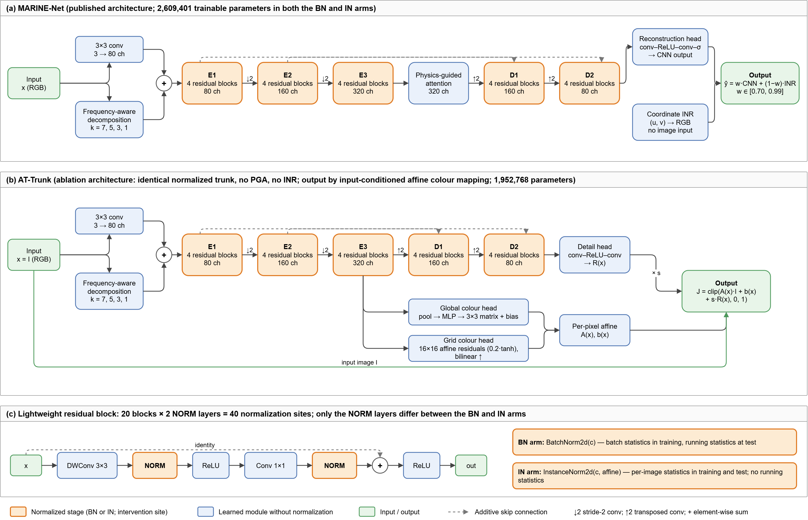

# Cross-dataset reversal of batch vs. instance normalization in underwater image enhancement

Code, frozen protocols and per-image results for the study **"Cross-dataset reversal in the relative performance of batch and instance normalization in two underwater image enhancement networks"**
Instance normalization (IN) is often preferred to batch normalization (BN) in underwater image enhancement, because it removes per-image feature statistics that vary with water conditions. This repository tests whether that preference holds across evaluation datasets under controlled conditions.

The design:
- **Swap:** the BN layers are replaced by IN layers at the same 40 sites in two networks. Everything else is identical: the training data, the recipe and three matched seeds per arm.
- **Networks:**
  - the published [MARINE-Net](https://github.com/swamynathanvp/MARINE-Net);
  - **AT-Trunk**, an ablation architecture that keeps MARINE-Net's normalized trunk but replaces pixel synthesis with an input-conditioned affine colour mapping.
- **Evaluation datasets:** three, whose references are built in different ways.



## Key results

Seed-mean IN − BN PSNR difference (dB). The 12 checkpoints were trained on LSUI with the best-validation rule.

| Evaluation set | Reference type | Pairs | MARINE-Net | AT-Trunk |
|---|---|---|---|---|
| UIEB-787 | curated enhancement | 787 | **+1.52** | **+0.47** |
| HICRD-2000 | computed restoration | 2,000 (188 scene clusters) | **−2.91** | **−2.11** |
| TUB turbidity series | low-turbidity photograph | 1,153 (33 scenes) | **−3.28** | **−2.92** |

- **Reversal in every seed:** IN beat BN on UIEB in every seed of both networks, and lost to BN on HICRD and TUB in every seed.
  - This held with best-validation and last-epoch checkpoints.
  - On HICRD and TUB it also held under aspect-preserving evaluation geometry.
- **Four-term decomposition:** the mean squared error was split exactly as MSE = A + C + G + R (brightness offset, colour offset, gain, spatial residual). The IN difference sat in different terms on each dataset:
  - colour offset and gain on UIEB;
  - brightness offset and gain on HICRD;
  - mainly the spatial residual on TUB.
- **Input baseline on TUB:** the unprocessed input scored higher than both normalization variants against the low-turbidity reference, at every turbidity decile.

**Conclusion:** the direction of a normalization effect depends on the evaluation data. Normalization choices should be validated on data representative of the intended use.

## Repository layout

| Path | Contents |
|---|---|
| `models/` | BN and IN variants of MARINE-Net (`marine_net_in.py`), AT-Trunk (`at_marine.py`, `at_trunk_in.py`), and wrappers for the WaterNet and WWE-UIE comparators |
| `models_v2/` | colour-transform heads used by AT-Trunk |
| `train_v2.py` | core training loop (recipes, checkpoint selection by validation PSNR) |
| `v2_tools/` | training wrappers, inference, statistical analyses, comparator evaluation and figure scripts |
| `tools/` | baseline reproduction utility |
| `datasets/splits/` | frozen split and cohort manifests (file lists and hashes; no images) |
| `reports/paper1_narrowed/` | frozen analysis protocols, amendments and result reports; scripts verify their SHA-256 before running |
| `runs_v2/<run>/` | per-run `result.json` (arguments, environment, best epoch, checkpoint SHA-256), `history.jsonl` (per-epoch loss and validation scores) and the loss configuration |
| `paper1_uieb_runs/` | per-image scores and analysis outputs (JSON/CSV) behind every number in the paper |
| `docs/` | architecture figure |

Not included:
- **Dataset images.** They are redistributed only by their owners; see "Data" below.
- **Trained checkpoints.** They are too large for this repository. Their SHA-256 values are in each `result.json`, and they are available from the corresponding author on reasonable request.
- **MARINE-Net code.** It is a dependency; see "Setup".

## Setup

The results were produced with Python 3.12.0 and PyTorch 2.7.1 (CUDA 11.8) on a single NVIDIA RTX 3070 GPU.

```bash
git clone https://github.com/YBalajiRao/bn-in-underwater-enhancement.git
cd bn-in-underwater-enhancement
pip install -r requirements.txt

# MARINE-Net building blocks (MIT licence), pinned to the commit used in this study
git clone https://github.com/swamynathanvp/MARINE-Net.git original_repo
git -C original_repo checkout 4ebc0dfbfb18b09c051a3e38fc73d580085cf0a1
```

Our models import `original_repo/marine_net_model.py`. MARINE-Net itself is used unchanged; only its 40 `BatchNorm2d` layers are swapped for `InstanceNorm2d(affine=True, track_running_stats=False)` in the IN arm.

## Data

Download each dataset from its official source and place it under `datasets/source_copies/`:

| Dataset | Role | Source | Expected location |
|---|---|---|---|
| LSUI | training (3,463 pairs) and Val-A selection set (166 pairs) | Peng et al., IEEE TIP 2023, [doi:10.1109/TIP.2023.3276332](https://doi.org/10.1109/TIP.2023.3276332) | `datasets/source_copies/LSUI` |
| UIEB | evaluation (UIEB-787 and the 90-pair gate cohort) | Li et al., IEEE TIP 2020, [doi:10.1109/TIP.2019.2955241](https://doi.org/10.1109/TIP.2019.2955241) | `datasets/source_copies/UIEB` |
| HICRD (version 2) | evaluation (1,700 train + 300 test pairs) | CSIRO Data Access Portal, [doi:10.25919/ahhq-0827](https://doi.org/10.25919/ahhq-0827) | `datasets/source_copies/HICRD/HICRD_paired_official_{train,test}` |
| TUB | evaluation (turbidity series) | [huggingface.co/datasets/vapaau/TUB](https://huggingface.co/datasets/vapaau/TUB), revision `6214f00807df5dbbfd389cddb4cecc41e9d62110` | `datasets/source_copies/TUB/hf_vapaau_TUB_rev6214f00807df` |

The manifests in `datasets/splits/` record the exact files and hashes of every split. Two optional paths are read from environment variables:
- `HICRD_ZIP`: the HICRD paired zip used by the overlap and clustering audits;
- `SOTA_ASSETS`: the folder holding released comparator checkpoints.

## Reproducing the study

**1. Training: 12 runs, 100 epochs each, about 5–8 h per run on an RTX 3070.** These are the commands recorded in each run's `result.json`; replace `S` with 0, 1 and 2.

```bash
# MARINE-Net, BN and IN arms
python v2_tools/train_v2_no_valb_marinenetms.py --recipe XF_R3_fp32_floor      --model marine_default    --seed S --run_name marinenet_bn_r3_fp32_sS
python v2_tools/train_v2_no_valb_marinenetms.py --recipe XFIN_R3_fp32_floor_IN --model marine_default_in --seed S --run_name marinenet_in_r3_fp32_sS
# AT-Trunk, BN and IN arms (seed 0 was run with train_v2_no_valb_xf.py / _xfin.py; seeds 1-2 with the multi-seed wrappers)
python v2_tools/train_v2_no_valb_xfms.py   --recipe XF_R3_fp32_floor      --model at_trunk    --seed S --run_name xf_attrunk_r3_fp32_sS
python v2_tools/train_v2_no_valb_xfinms.py --recipe XFIN_R3_fp32_floor_IN --model at_trunk_in --seed S --run_name xfin_attrunk_in_r3_fp32_sS
```

The BN and IN models of each seed share their initialization, data order and augmentation. The `*_gate.py` scripts validate each finished run:
- recorded arguments and parameter count;
- 100 contiguous epochs with finite losses;
- manifest hashes;
- a re-scored validation PSNR.

**2. Evaluation and analysis.** Every script documents its options under `--help`. Outputs are written to `paper1_uieb_runs/`, and the versions used in the paper are already included.

| Analysis | Script(s) | Output folder(s) |
|---|---|---|
| UIEB-787 inference | `v2_tools/stage3_infer.py` | `stage3_uieb800_best_valA`, `stage3_uieb800_last` |
| UIEB colour-cast associations (pre-specified) | `v2_tools/stage3_h3_analysis.py` | `stage3_analysis_*` |
| HICRD inference (256×256 and 482×256) | `v2_tools/stage4_infer.py` | `stage4_hicrd2000_*` |
| HICRD scene clusters (T30) and analysis | `v2_tools/stage4_scene_overlap.py`, `v2_tools/stage4_analysis.py` | `stage4_prep`, `stage4_analysis_*` |
| TUB audit, inference and analysis | `v2_tools/tub_dataset_audit.py`, `v2_tools/tub_stage5_infer.py`, `v2_tools/tub_stage5_analysis.py` | `tub_audit`, `tub_stage5_*`, `tub_stage5_analysis_*` |
| Four-term error decomposition | `v2_tools/s5_e1r_error_decomposition.py`, `v2_tools/s5_e1r_analysis.py` | `s5_e1r`, `s5_e1r_analysis` |
| Reference-demanded correction | `v2_tools/s5_x1_required_correction.py` | `s5_x1` |
| Bootstrap intervals of the mean difference | `v2_tools/paper1_o1_mean_d_cis.py` | `paper1_O1_mean_d_cis` |
| TUB PSNR vs. turbidity, input baseline | `v2_tools/paper1_o2_tub_psnr_vs_ntu.py`, `v2_tools/paper1_o7_tub_input_psnr.py` | `paper1_O2_tub_psnr_vs_ntu`, `paper1_O7_tub_input_psnr` |
| Published methods on HICRD-2000 | `v2_tools/sota_hicrd_protocol.py`, `v2_tools/sota_hicrd_infer_r.py`, `v2_tools/sota_hicrd_infer_t.py`, `v2_tools/sota_classical.py`, `v2_tools/sota_hicrd_analysis.py` | `sota_hicrd_*` |
| Numerical audit of all reported values | `v2_tools/paper1_previz_numerical_audit.py` | `paper1_previz_audit` |
| Figures | `v2_tools/paper1_final_figures.py` | the folder given by `--out` |

Released comparator checkpoints (U-Shape, WWE-UIE, FUnIE-GAN, NU²Net) must be obtained from their authors' official repositories. Their licences apply; the NU²Net checkpoint is for non-commercial use only.

## Statistical design in brief

- **Paired effect:** d = PSNR(IN) − PSNR(BN) per image and seed, summarized per seed and as a seed mean.
- **Uncertainty:** 95% percentile bootstrap (B = 10,000), resampling by the unit of each cohort: image (UIEB), T30 scene cluster (HICRD) or scene (TUB).
  - Pre-specified correlations use 97.5% intervals.
  - Seed-level t intervals (2 degrees of freedom) are reported separately.
- **Pre-specification:** analyses marked "pre-specified" follow the frozen protocols in `reports/paper1_narrowed/`, which the scripts hash-check.

## Citation

If you use this code or the results, please cite the accompanying article (bibliographic details will be added on publication):

> Y. B. Rao, S. Sriram. Cross-dataset reversal in the relative performance of batch and instance normalization in two underwater image enhancement networks.

and the MARINE-Net base architecture:

> S. Sriram et al. MARINE-Net: Memory-aware restoration with implicit neural enhancement for resource-constrained underwater image restoration. *Pattern Recognition* 180 (2026) 114463. [doi:10.1016/j.patcog.2026.114463](https://doi.org/10.1016/j.patcog.2026.114463)

## Contact

Please open an issue in this repository. For checkpoint requests, ybalajirao30@gmail.com
